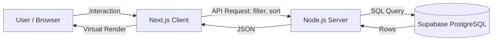

# Virtual Scroll Dashboard (Frontend)

> 1만 건 규모의 데이터를 DOM 노드 수를 늘리지 않고 렌더링하는 어드민 대시보드입니다.
> 가상 스크롤(Windowing)로 렌더링 비용을 데이터 양과 분리하고, 필터 상태를 URL로 관리해 새로고침·공유·뒤로가기에서 화면이 유지되도록 구현했습니다.

**Live Demo** — https://project3.enaeble.co.kr
**Backend** — https://github.com/E-nae/virtual_scroll_dashboard_backend

---

## Tech Stack

### Frontend

| Tech | Usage |
| :--- | :--- |
| **Next.js** | App Router 기반 프론트엔드 |
| **TypeScript** | 정적 타입 |
| **TanStack Query** | 서버 상태 관리 (캐싱, 리페칭) |
| **TanStack Virtual** | 가상 스크롤(Windowing) |
| **Nuqs** | URL Query String ↔ React State 동기화 |
| **Recharts** | 차트 |
| **Tailwind CSS** | 스타일링 |
| **shadcn/ui** | 컴포넌트 |

### Backend (별도 저장소)

| Tech | Usage |
| :--- | :--- |
| **Node.js / Express** | REST API |
| **Supabase** | PostgreSQL 관리형 DB |

---

## 구현하면서 다룬 문제들

### 1. 행이 많아질수록 스크롤이 끊기는 문제

**상황.** 1만 건을 일반 `<table>`로 렌더링하면 DOM 노드가 그만큼 생성됩니다. 초기 렌더가 길어지고 스크롤 중 프레임이 끊깁니다.

**접근.** TanStack Virtual로 뷰포트에 들어오는 15~20행만 렌더링하고, 전체 높이만큼 컨테이너를 잡아 스크롤바 길이를 맞췄습니다. 스크롤 위치에 따라 렌더 구간을 다시 계산합니다.

**결과.** 실제로 존재하는 행 DOM은 데이터가 몇 건이든 20개 안팎으로 유지됩니다. 렌더링 비용이 전체 데이터 양이 아니라 화면 높이에 비례하게 됐습니다.

**한계.** 가상화가 해결하는 건 **렌더링 비용뿐**입니다. 응답 크기, JSON 파싱 시간, 메모리에 올라간 배열은 그대로입니다. 아래 "알려진 한계" 항목에 이어서 적었습니다.

### 2. 필터를 걸어둔 화면을 공유하거나 새로고침하면 초기화되는 문제

**상황.** 검색어와 상태 필터를 컴포넌트 state로 들고 있으면 새로고침하는 순간 사라지고, 링크를 공유해도 상대는 빈 화면을 봅니다.

**접근.** `nuqs`로 필터 상태의 원본을 URL Query String에 두고 React state와 양방향으로 동기화했습니다. 상태를 두 군데 두고 맞추는 대신 URL을 단일 출처로 삼았습니다.

**결과.** 링크를 그대로 공유하면 같은 화면이 열리고, 브라우저 뒤로가기·앞으로가기가 필터 이력으로 동작합니다.

### 3. 검색어를 입력할 때마다 요청이 나가는 문제

**상황.** 입력 이벤트마다 API를 호출하면 타이핑 한 번에 요청이 여러 개 나가고, 응답이 도착하는 순서에 따라 화면이 깜빡입니다.

**접근.** 디바운스를 걸어 입력이 멈춘 뒤에만 요청이 나가도록 했습니다. 그리고 요청 대기 구간에 화면이 비지 않도록, `isFetching` 상태와 로컬 입력값을 조합해 이전 결과를 유지한 채 로딩 표시만 얹었습니다.

**한계.** 디바운스 지연값은 직접 써보며 체감으로 정한 값이고, 실사용 데이터로 측정해 조정하지는 않았습니다.

### 4. 테스트 데이터 1만 건 적재

**상황.** 가상화 효과를 확인하려면 실제로 많은 행이 필요했는데, Supabase의 기본 응답 행 수 제한에 걸렸습니다.

**접근.** Node.js 시딩 스크립트로 CSV를 만들어 Bulk Insert 했고, Supabase의 Max Rows 설정과 서버 쿼리의 `.range()`를 조정했습니다. Primary Key는 UUID로 두었습니다.

---

## 알려진 한계

이 프로젝트는 가상화와 URL 상태 동기화를 직접 구현해보는 것이 목적이라, 아래는 의도적으로 다루지 않았거나 실제 서비스라면 다르게 갔을 부분입니다.

- **데이터를 한 번에 받습니다.** 가상화의 효과를 분리해서 보려고 페이지네이션 없이 전체를 내려받는 구조로 두었습니다. 그래서 렌더링은 데이터 양과 무관해졌지만 네트워크 전송량과 파싱 비용은 그대로 남아 있습니다. 실제 서비스라면 커서 기반 페이징이나 무한 스크롤로 나눠 받는 것이 맞습니다.
- **성능을 수치로 측정하지 않았습니다.** DOM 노드 수가 일정하게 유지되는 것은 확인했지만, 프레임 단위 측정이나 Lighthouse 기반 비교는 하지 않았습니다.
- **인증과 권한이 없습니다.** 어드민 화면을 가정했지만 로그인 흐름은 범위 밖으로 두었습니다.
- **테스트 코드가 없습니다.**

---

## Architecture



---

## Getting Started

이 저장소는 프론트엔드입니다. API 서버는 [virtual_scroll_dashboard_backend](https://github.com/E-nae/virtual_scroll_dashboard_backend)를 함께 실행해야 합니다.

```bash
pnpm install
pnpm dev
```

`http://localhost:3000` 에서 확인할 수 있습니다.

### 환경 변수

프로젝트 루트에 `.env.local` 파일을 만들고 API 서버 주소를 지정합니다.

```
NEXT_PUBLIC_API_URL=http://localhost:4000
```

---

## 배운 점

- **가상화는 렌더링 문제만 푼다.** 도입 전에는 "대용량 데이터 처리"를 하나의 문제로 봤는데, 실제로는 렌더링·네트워크·파싱·메모리가 각각 다른 문제였습니다. 가상화로 DOM 노드 수를 고정한 뒤에도 응답이 커지면 여전히 느려지는 걸 보고 구분하게 됐습니다.
- **상태의 원본을 어디에 둘지가 UX를 결정한다.** 필터 상태를 컴포넌트 안에 두느냐 URL에 두느냐는 구현 편의의 문제로 보였지만, 공유·새로고침·뒤로가기라는 사용자 행동이 되느냐 마느냐를 가르는 선택이었습니다.
- **서버를 분리하니 책임이 나뉘었다.** Next.js 안에서 다 처리할 때보다 필터링·정렬 로직의 위치가 분명해졌습니다. 다만 요청이 한 단계 더 거쳐 가는 비용도 함께 생겼습니다.
